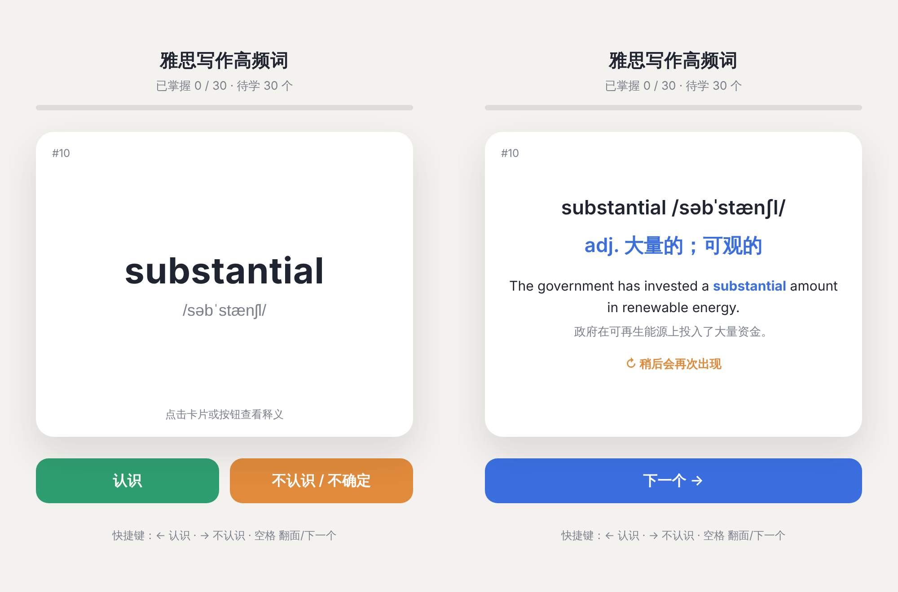

# 雅思高频词卡片

一个打开就能用的雅思写作高频词卡片网页：看英文、想意思、翻面核对，不熟的词会自动再出现。

**在线体验：** https://vianoo116.github.io/ielts-vocab-cards/

## 为什么做

背雅思单词时，真正花时间的是那些"有点眼熟但说不准"的词。按顺序把词表从头翻到尾，认识的词和不熟的词出现的次数一样多，时间都花在了已经会的词上。

这个卡片只做一件事：**不熟的词要反复出现，直到你真的认识它。**

## 功能

- **一次一张卡片**：正面只显示英文单词和音标，先自己回想意思
- **两种判断**：「认识」或「不认识 / 不确定」，点任一按钮都会翻到背面
- **背面核对**：中文释义、英文例句（目标词高亮）和例句的中文翻译
- **不熟的词稍后再出现**：选「不认识 / 不确定」（或直接点卡片翻面）的词，会随机隔 3–7 张重新出现，并标记「复习」，直到选「认识」为止；剩下的卡片不够时放到最后
- **「记错了」按钮**：点「认识」翻面后，如果发现自己其实记错了意思，可以点「下一个」旁边的「记错了」，这个词会按「不认识」处理，稍后再出现
- **进度可见**：顶部显示已掌握数量、待学数量和进度条，全部掌握后可以再来一轮
- **本轮统计**：完成页显示本轮点「认识」的总次数、其中点了「记错了」的次数，以及记错率（记错次数 ÷ 认识次数）
- **每轮随机顺序**，避免靠位置记词
- **内置 30 个雅思写作高频词**，例句贴近写作常见话题（教育、环境、科技、城市化等）
- **键盘快捷键（电脑端）**：`←` 认识，`→` 不认识，`空格` 翻面 / 下一个；手机上不显示提示
- 适配手机屏幕，跟随系统自动切换深色模式

## 技术栈

- 原生 HTML + CSS + JavaScript，全部写在一个 `index.html` 文件里
- 无框架、无构建步骤、无外部依赖，离线也能用
- CSS 3D 变换实现卡片翻转动画
- 通过 GitHub Pages 部署

本地运行：下载 `index.html`，双击用浏览器打开即可。

## 产品决策

1. **第一版只做 30 个词**：先验证「翻卡 + 不熟的词反复出现」这个核心流程好不好用，再扩充词库。代价是词量少，还不能真正用来备考。
2. **不做登录，也不保存进度**：单个网页，打开就能用，没有门槛。代价是刷新后进度会丢失。
3. **新增「记错了」按钮**：点了「认识」翻面后，用户常发现自己其实记错了意思。给这种「自以为认识」的情况一个出口，把词重新放回复习队列。
4. **不熟的词随机隔 3–7 张再出现**：固定张数会让人刻意等着这个词出现，变成短期记忆。随机间隔更接近真实回忆；设上限，是为了保证它在本轮内一定会再出现。
5. **点卡片翻面按「不确定」处理**：想偷看答案，本身就说明不熟，所以计入复习。
6. **键盘快捷键只在电脑端使用**：在电脑上，键盘比鼠标和触控板更快；手机上用不到，所以不显示。

## 迭代计划（按优先级）

| 优先级 | 计划 | 原因 |
| --- | --- | --- |
| P1 | 拼写模式：看中文，拼出英文 | 雅思已改为机考，很多人想得起单词却拼不对 |
| P1 | 点击音标播放发音 | 用浏览器自带朗读实现，没有额外成本和版权问题 |
| P2 | 手机单手模式：按钮集中在拇指能够到的区域 | 现在手机屏幕大，单手点上方的按钮不方便 |
| P2 | 在浏览器里保存学习进度 | 解决刷新后进度丢失的问题 |
| P3 | 可选的「专注模式」：10 秒倒计时，可暂停，切走页面时自动暂停 | 假设倒计时能减少走神，但也可能带来压力，所以做成可选，并先观察使用数据 |
| P3 | 扩充词库 | 使用开源词典（如 ECDICT）并注明来源，例句自行编写，避免版权问题 |

## 怎么判断好不好用

- 一轮学完的完成率
- 平均每个词复习几次才掌握
- 「记错了」按钮的使用频率，用来验证「自以为认识」是不是真实存在的问题
- 下一步：找 5 位正在备考雅思的同学试用，收集反馈
